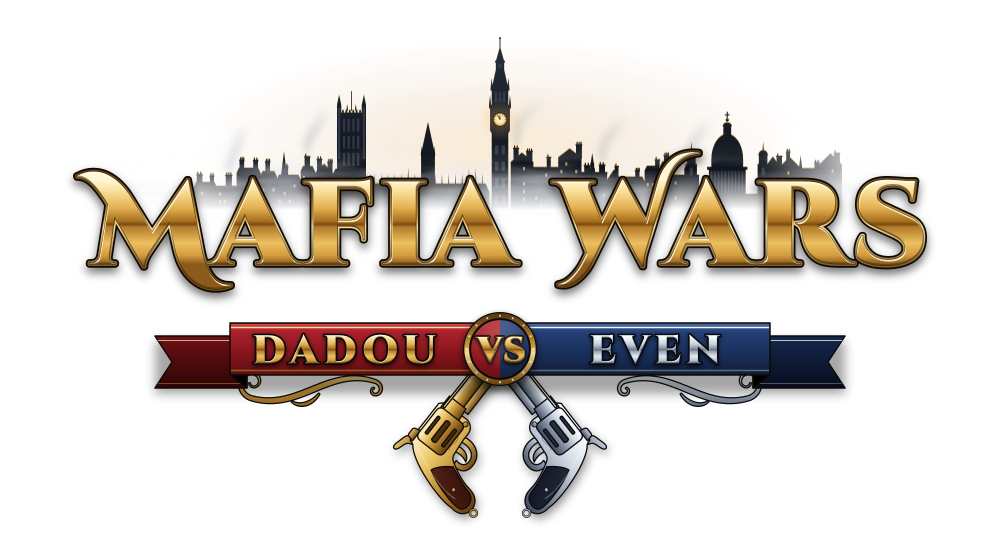

<p align="center">
  
</p>

# MAFIA WARS : Dadou vs Even

Londres, 1888. Deux parrains se disputent la capitale : **Dadou**, le flamboyant parrain de Soho
(manteau noir, chapeau melon, moustache en guidon), et **Even**, l’élégant parrain des Docks
(redingote bleu marine, haut-de-forme et monocle). Chacun dirige sa mafia — **La Mafia de Dadou**
et **La Mafia d’Even** — depuis son quartier général, recrute des hommes, engage des lieutenants
et part à la conquête des six quartiers de Londres.

Jeu **3D voxel multijoueur en ligne pour deux joueurs**, dans le navigateur, entièrement en français.

- Client : Three.js (r180) + TypeScript + Vite
- Serveur : Node.js + Socket.IO, **serveur autoritaire** (IA, combats, captures, économie)
- Tous les graphismes sont des voxels procéduraux, tous les sons et musiques sont synthétisés :
  aucun fichier externe n’est téléchargé.

---

## Le plus simple : la version Windows (.exe)

Pas besoin d’installer Node.js : téléchargez
[`release/MafiaWars-Windows.zip`](release/MafiaWars-Windows.zip), décompressez-le et
double-cliquez sur **MafiaWars.exe**. Une fenêtre (le serveur du jeu) s’ouvre, puis le jeu
s’ouvre dans votre navigateur. Gardez cette fenêtre ouverte pendant la partie.

- Le programme n’est pas signé : si Windows affiche « Windows a protégé votre ordinateur »,
  cliquez sur « Informations complémentaires » puis « Exécuter quand même ». Autorisez le
  pare-feu sur les réseaux privés pour jouer à deux.
- Un seul joueur lance l’exécutable : il crée la partie et envoie le lien d’invitation à son
  adversaire, qui l’ouvre simplement dans son navigateur (même réseau Wi-Fi ou câble).
- Pour refabriquer l’exécutable : `npm run build:exe` (→ `release/MafiaWars.exe`), ou
  `npm run build:exe -- linux` pour un binaire Linux. Le binaire Node.js officiel de la
  version utilisée est téléchargé depuis nodejs.org, puis le jeu y est intégré.

## Démarrage rapide (développement)

Prérequis : **Node.js 20 ou plus récent** (testé avec Node 22) et un navigateur récent avec WebGL 2
(Chrome, Edge, Firefox, Safari 16+).

```bash
npm install
npm run dev
```

Puis ouvrez **http://localhost:5173** dans deux navigateurs (ou deux onglets, ou deux ordinateurs) :

1. Joueur 1 : « Créer une partie » → un code de salon à 4 lettres s’affiche (et un lien d’invitation à copier).
2. Joueur 2 : « Rejoindre une partie » → saisir le code (ou ouvrir directement le lien d’invitation).
3. Dans le salon « Choisissez votre parrain » : l’un clique sur **Jouer Dadou**, l’autre sur **Jouer Even**
   (un parrain choisi devient indisponible pour l’autre).
4. Les deux joueurs cliquent sur « Je suis prêt ! » : la partie démarre.

`npm run dev` lance en même temps :

| Processus | Adresse | Rôle |
| --- | --- | --- |
| serveur de jeu (`tsx watch src/server/main.ts`) | port **3000** | salons, simulation autoritaire à 20 Hz |
| client (`vite`) | port **5173** | interface et rendu 3D ; relaie Socket.IO vers le port 3000 |

On peut aussi les lancer séparément : `npm run dev:server` et `npm run dev:client`.

## Version de production

```bash
npm run build     # compile le client (dist/client) et le serveur (dist/server/main.js)
npm start         # sert le jeu ET le multijoueur sur http://localhost:3000
```

Un seul processus Node sert alors les fichiers du jeu et les connexions Socket.IO.
Variables d’environnement : `PORT` (3000 par défaut), `HOST` (0.0.0.0 par défaut),
`CLIENT_DIR` (dossier du client compilé, `dist/client` par défaut).

## Jouer en réseau local (LAN)

1. Sur l’ordinateur qui héberge : `npm run build && npm start` (ou `npm run dev`).
2. Le serveur affiche son adresse sur le réseau local, par exemple :
   ```
   Sur le réseau local :  http://192.168.1.20:3000
   ```
3. L’autre joueur ouvre cette adresse dans son navigateur (port **3000** en production,
   port **5173** avec `npm run dev`).
4. Si la page ne s’ouvre pas, autorisez Node.js dans le pare-feu de l’ordinateur hôte.

## Jouer par Internet

- **Hébergement simple** : déployez la version de production sur n’importe quel hébergeur Node
  (VPS, Render, Railway, Fly.io…) avec `npm install && npm run build` puis `npm start`.
  Le port d’écoute est lu dans `PORT`. Les deux joueurs ouvrent l’adresse publique.
- **Depuis chez soi** : redirigez le port TCP 3000 de votre box vers l’ordinateur hôte, puis donnez
  votre adresse IP publique (`http://votre-ip:3000`) à votre adversaire.
- **Derrière un proxy inverse** (nginx, Caddy…) : activez la prise en charge des WebSockets
  (`Upgrade`/`Connection`) pour le chemin `/socket.io/`.
- Un client servi ailleurs peut viser un autre serveur avec `?server=https://mon-serveur.example`.

## Reconnexion

Chaque onglet garde un identifiant de session : en cas de coupure ou de rechargement de la page,
le joueur retrouve automatiquement sa place, son parrain et son empire. Si un joueur se déconnecte
pendant la partie, celle-ci est mise en pause (jusqu’à 3 minutes) le temps qu’il revienne.

---

## Commandes (par défaut)

Toutes les touches sont modifiables dans **Paramètres → Commandes** (avec détection des conflits :
échanger, remplacer ou annuler) et sont enregistrées dans le navigateur. Les touches suivent la
position physique : sur un clavier AZERTY, « Avancer » est sur **Z**, « Pas à gauche » sur **Q**…
et l’affichage s’adapte à votre disposition.

| Action | Touche (QWERTY) | Sur AZERTY |
| --- | --- | --- |
| Se déplacer | W A S D | Z Q S D |
| Sprinter | Maj gauche | Maj gauche |
| Sauter / s’accroupir | Espace / C | Espace / C |
| Tirer / frapper | clic gauche | clic gauche |
| Viser | clic droit | clic droit |
| Recharger | R | R |
| Armes | 1 2 3 4, molette | & é " ' , molette |
| Interagir (bureau, comptoir, armurerie, achats) | E | E |
| Changer de vue (1re / 3e personne) | V | V |
| Roue des ordres rapides | Q (maintenir) | A (maintenir) |
| Carte de Londres | M | , |
| Discuter | Entrée | Entrée |
| Bilan de la partie | Tab | Tab |
| Menu pause | Échap | Échap |

## Comment jouer

- **Objectif** : contrôler les quartiers de Londres. Un quartier appartient à celui qui tient
  **tous ses bâtiments clés ★**. Avec au moins **3 quartiers**, le QG adverse devient prenable :
  sa capture donne la victoire (« DADOU RÈGNE SUR LONDRES ! » / « EVEN RÈGNE SUR LONDRES ! »).
  Une durée de partie peut être fixée dans le salon (victoire aux territoires à la fin du temps).
- **Départ** : un pub modeste comme QG (Le Lion Rouge à Soho pour Dadou, L’Ancre Bleue aux Docks
  pour Even), 5 gangsters, 500 £, un revolver et un lieutenant (Arthur Collins / William Hayes).
- **Le bureau** : au fond du QG, la pièce marquée « Bureau de Dadou » / « Bureau d’Even ».
  Appuyez sur **E** devant la table de travail pour ouvrir la **carte stratégique** : cliquez un
  bâtiment ou un quartier → « Attaquer » → choisissez le lieutenant et le nombre d’hommes →
  « Lancer l’attaque ». Les lieutenants exécutent les ordres physiquement dans la ville
  (attaquer, défendre, patrouiller, suivre le patron, renforcer, tenir une position, se replier)
  et envoient des rapports (« ATTAQUE EN COURS — WHITECHAPEL / Lieutenant : Arthur Collins /
  Hommes restants : 23/30 / Progression : 60 % »).
- **Capturer un bâtiment** : éliminez ses défenseurs et restez à l’intérieur avec vos hommes.
  Les bâtiments neutres sans défenseurs peuvent aussi être achetés (touche E à l’intérieur).
- **Ordres rapides** : maintenez **Q** près de vos hommes : « Suivez-moi », « Attaquez »
  (la cible visée), « Défendez », « Repliez-vous ».
- **Recrutement** : au comptoir du QG (« Recruter 1 / 5 / 10 gangsters »), lieutenants
  supplémentaires, améliorations (armes, gilets, gardes, Télégraphe pour donner des ordres depuis
  la carte M, armurerie…).
- **Économie** : chaque bâtiment rapporte un revenu par minute, plus un bonus par quartier contrôlé.
- **Police** : les coups de feu en public et les meurtres de passants font monter votre niveau de
  recherche ; Scotland Yard envoie des agents. Cachez-vous pour qu’elle perde votre trace.
- **Mort du parrain** : réapparition au QG après quelques secondes, contre une petite amende.
- **Événements** : cargaisons de contrebande à récupérer, descentes de police, brouillard épais,
  informateurs ; « La Gazette de Londres » commente la guerre des gangs.
- **Première mission** : « PREMIÈRE MISSION — PRENEZ LE CONTRÔLE » guide les premiers pas
  (désactivable dans le salon).

---

## Organisation du code

```
src/
  shared/              code commun client/serveur
    city/plan.ts       quartiers, 35 bâtiments, rues, quais
    city/gen/          génération voxel de Londres (façades, toits, intérieurs meublés)
    voxel.ts nav.ts    monde voxel (0,25 m), grille de navigation et A*
    protocol.ts        messages réseau, instantanés binaires
    constants.ts       règles : économie, recrutement, améliorations, ordres
  server/
    main.ts            serveur HTTP + Socket.IO
    room.ts            salons, choix des parrains, prêts, pause et reconnexion
    game/              simulation : IA, escouades, police, captures, événements, victoire
  client/
    app.ts             enchaînement des écrans
    ui/screens/        menu, salon, paramètres, commandes, aide, chargement, pause, victoire
    game/              client de jeu : joueur, armes, HUD, carte stratégique, roue des ordres,
                       mission d’introduction, portes, enseignes, passants, vue subjective
    render/            maillage voxel, lumière précalculée, ciel, eau, halo lumineux
    characters/        personnages voxel et animation procédurale
    models/props/      ~90 types d’accessoires modélisés en voxels (155 variantes)
    audio/             sons et musiques synthétisés (Web Audio)
public/brand/          logo, emblèmes, icônes (générés par scripts/build-logo.mjs)
tests/                 tests automatiques
```

## Tests

```bash
npm run typecheck      # vérification TypeScript stricte
npm test               # tests sans navigateur : génération, navigation, simulation complète
                       # (ordres → combats → captures), économie, événements, victoire, textes
node tests/e2e.mjs     # test de bout en bout dans un vrai navigateur (Playwright)
node tests/rematch.mjs # réseau : salon, reconnexion, pause, fin de partie, revanche
                       # (serveur lancé avec MW_DEBUG=1)
```

`tests/e2e.mjs` parcourt menu, salon, choix des parrains, partie, tir, roue des ordres, carte
stratégique avec ordre d’attaque, onglets du bureau et pause, en enregistrant des captures d’écran.
Il suppose le serveur de jeu sur le port 3000 et le client sur 5173. Options (variables
d’environnement) : `URL` (autre adresse), `BOT=1` (l’adversaire est un client Socket.IO sans
navigateur, `tests/bot.mjs`), `LOWGFX=1` (graphismes au minimum), `API_LOBBY=1` (salon piloté par
le réseau plutôt que par les boutons). Lancé avec `MW_DEBUG=1`, le serveur accepte en plus une
téléportation de test, utile sur les machines sans carte graphique.

## État du projet et limites connues

Ce qui fonctionne : salon en ligne à deux joueurs avec choix exclusif des parrains et
reconnexion, ville de Londres complète et visitable (tous les bâtiments ont un intérieur meublé),
déplacement en 1re et 3e personne, combats (revolver, fusil, carabine, couteau, matraque, poings),
IA des gangsters, voyous, policiers et lieutenants, ordres exécutés physiquement, captures,
territoires, économie, améliorations, police et niveau de recherche, événements aléatoires,
journal, victoire et revanche, paramètres graphiques, sonores et touches modifiables, passants qui
fuient les coups de feu et fiacres tirés par des chevaux dans les rues.

Vérifié automatiquement : 47 contrôles sans navigateur (`npm test`), un scénario réseau complet
(`tests/rematch.mjs`) et un parcours de bout en bout dans Chromium (`tests/e2e.mjs`). Une
simulation de charge (230 gangsters qui se battent) tient en 2 à 4 ms par tick serveur.

Limites actuelles, en toute transparence :

- Les **passants** sont simulés localement par chaque navigateur : les deux joueurs ne voient pas
  exactement la même foule (les gangsters, lieutenants, policiers et parrains, eux, sont
  synchronisés par le serveur).
- Les **fiacres** qui circulent dans les rues sont, comme les passants, propres à chaque
  navigateur et purement décoratifs (ils s’arrêtent devant les piétons mais ne bloquent personne).
- La ville est générée par chaque client au démarrage (quelques secondes, dans un *worker*).
- Le jeu demande une carte graphique : sur une machine sans accélération matérielle (rendu
  logiciel), les menus et le jeu deviennent très lents. Les réglages « Basse » ou « Moyenne »
  et une échelle de rendu réduite aident sur les petites configurations.
- Une partie oppose exactement deux joueurs humains (pas d’adversaire contrôlé par l’ordinateur).

## Crédits

Jeu créé pour Dadou et Even. Technologies : Three.js, Socket.IO, Vite, TypeScript, Node.js.
Polices : Cinzel, Cinzel Decorative, EB Garamond et UnifrakturMaguntia (SIL Open Font License).
Graphismes voxel procéduraux et sons synthétisés réalisés pour le projet.
